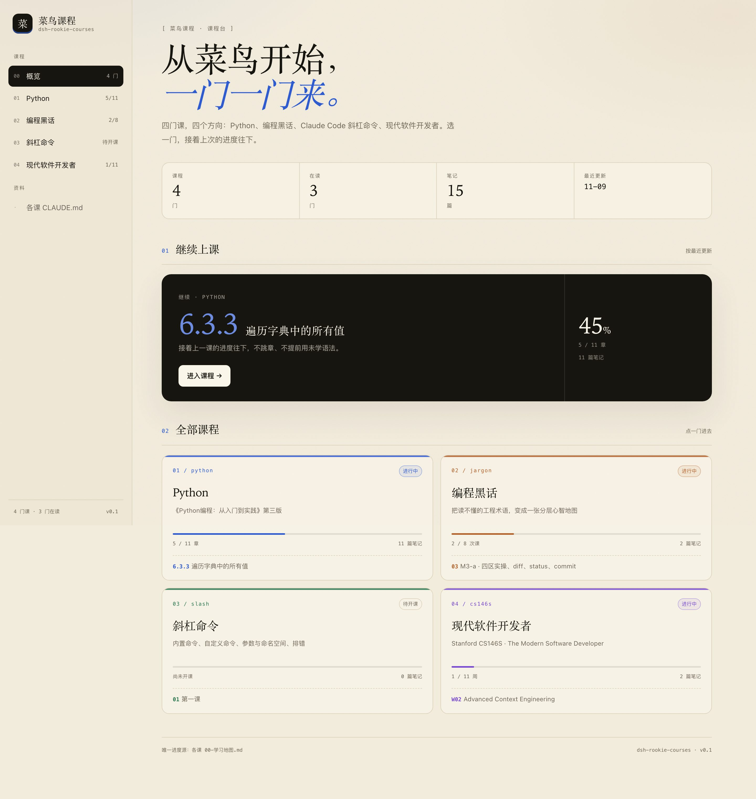
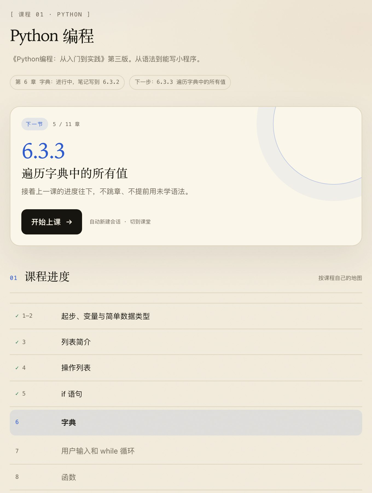

# 菜鸟课程 · dsh-rookie-courses

一个 DSH 课程台插件：左边栏「菜鸟课程」→ 选课 → 开始上课。
上课时官方对话居中，右侧栏自动打开「菜鸟课程」看板，显示这门课的进度、笔记与问答。



## 四门课

| 课程 | 学什么 | 课程约定 |
|---|---|---|
| Python | 《Python编程：从入门到实践》第三版，按章节推进 | 仓库 `CLAUDE.md` + `python-course` 技能 |
| 编程黑话 | 工程术语的分层心智地图，Pass 1 八次课 | 仓库 `CLAUDE.md`（术语六项、大白话规则） |
| Claude Code 斜杠命令 | 内置命令、自定义命令、参数与排错 | 仓库 `CLAUDE.md`（命令必须实跑） |
| 现代软件开发者 | Stanford CS146S，LLM 时代的软件工程 | 仓库 `CLAUDE.md`（每周读材料、复现、落笔记） |

插件不自带课程正文；每门课的课程页有「课程说明」按钮，会读该仓库的 `CLAUDE.md`，Python 还会附上 `python-course` 技能全文。

## 功能

- **课程台**：概览、四门课卡片、每门课的下一节、进度表、全部笔记。
- **一键开课**：在课程目录对应的 workspace 新建会话、发送开课指令，并打开右侧看板。
- **看板内读笔记**：点笔记卡片，在看板里读完整 Markdown，包括「问答记录」。
- **只读**：不写课程仓库的笔记、不改地图。



## 安装

本插件通过 GitHub 分发，没有发布到 npm。

```sh
dsh plugin --profile desktop add git+https://github.com/Jetson7817/dsh-rookie-courses.git
```

要求 DSH `>=0.2.1-rc.2 <0.3.0`，Node `>=22.19`。

## 插件市场

索引地址：

```text
https://jetson7817.github.io/dsh-rookie-courses/market/index.json
```

在 DSH 里启用 `@deepseek-ai/dsh-experimental-plugin-market-bundle`，把上面的地址加进 Discover / Settings 的 index 列表即可。索引里的版本固定到 git commit，升级时更新索引。

## 配置课程

插件不自带课程内容。第一次打开会提示创建：

`~/.dsh/rookie-courses.json`

```json
{
  "courses": [
    {
      "id": "python",
      "name": "Python",
      "full": "Python 编程",
      "dir": "/绝对路径/python课程笔记",
      "workspace": "python课程笔记",
      "parser": "python",
      "unit": "章",
      "accent": "#2f5bd1",
      "prompt": "/python-course 继续上 Python 课，先读 00-学习地图.md 确认下一步，再按技能规则开讲。"
    }
  ]
}
```

也支持环境变量 `ROOKIE_COURSES_CONFIG` 指向别的配置文件。

| 字段 | 说明 |
|---|---|
| `id` | 小写字母、数字、短横线，会话里用它定位课程 |
| `name` / `full` | 侧栏简称 / 页面标题 |
| `dir` | 课程仓库绝对路径 |
| `workspace` | DSH workspace 名，缺省用目录名 |
| `parser` | `python` / `jargon` / `slash` / `cs146s` |
| `unit` | 进度单位，如「章」「次课」「周」 |
| `accent` | 课程强调色 |
| `prompt` | 开课时发送的第一条消息 |

## 课程仓库约定

每门课必须有 `00-学习地图.md`，按 `parser` 使用对应结构：

| parser | 结构 |
|---|---|
| `python` | 当前进度 / 下一步 / 章节表 / `笔记/` |
| `jargon` | 13 个模块 / Pass 1 八次课 / `M0*.md` |
| `slash` | 课程记录表 / `笔记/` |
| `cs146s` | 11 周表 / `笔记/` |

课程仓库的 `CLAUDE.md` 会在会话里被 DSH 自动读取；Python 课另外用 `/python-course` 技能。

## 结构

| 文件 | 作用 |
|---|---|
| `lib/courses.js` | 配置读取、四种地图解析器 |
| `lib/index.js` | `/rookie-courses/api/*` 与静态页面 |
| `lib/client.js` | 侧栏入口、主面板、右侧标签、开课流程 |
| `web/` | 课程台页面（原生 HTML/CSS/JS） |
| `docs/` | 截图 |

## 开发

```sh
dsh plugin --profile desktop add file:/absolute/path/to/dsh-rookie-courses
```

插件通过 `dsh.bundle.patch` 注册 Host 行，通过 `dsh.client` 加载浏览器半边。
配置在每次请求时重新读取；Host 代码改动需要重载插件（禁用再启用 bundle）。

## 许可

MIT
